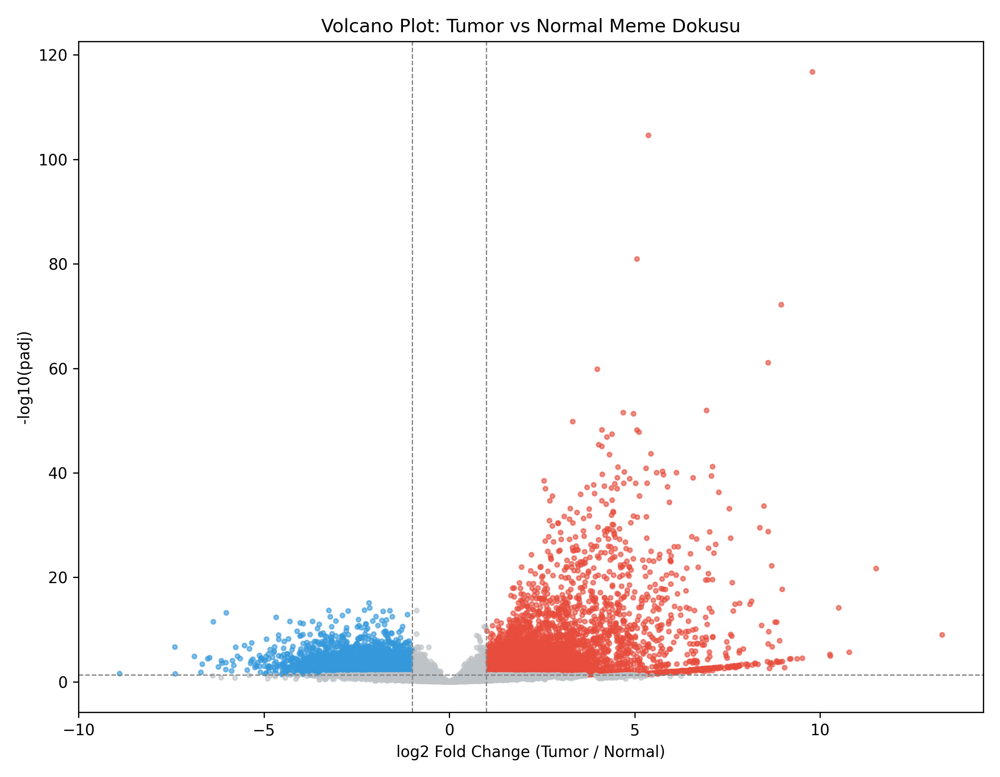
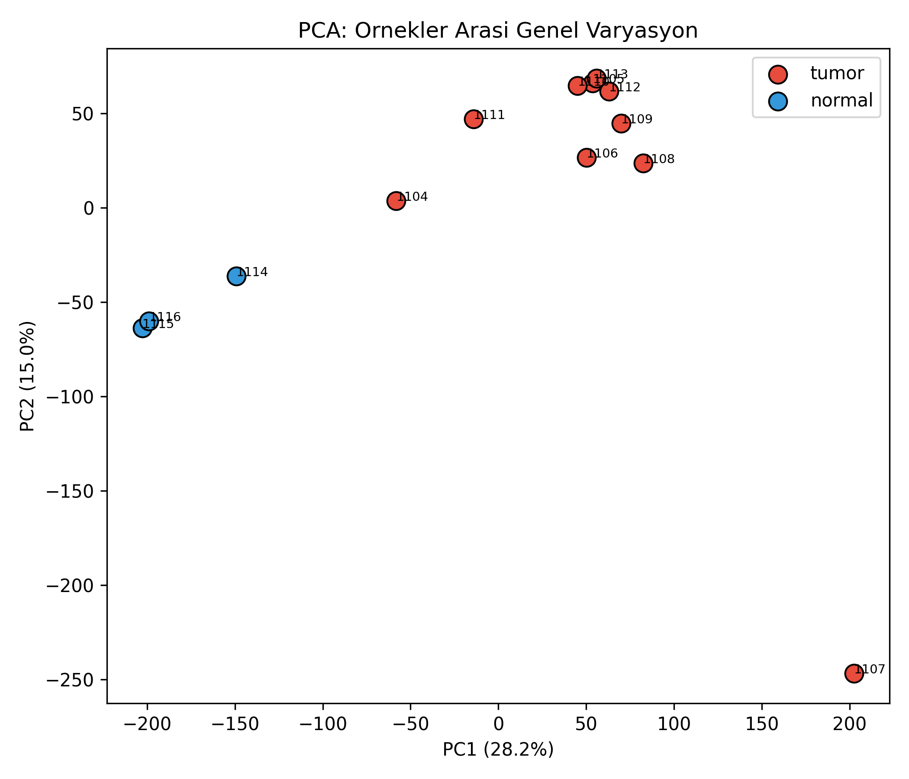
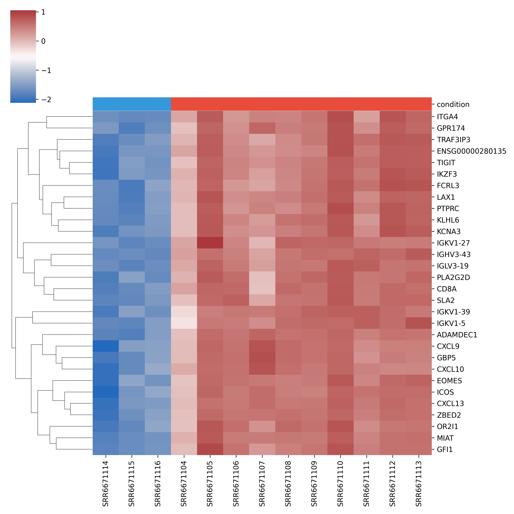

# Meme Kanseri RNA-seq Farkli Ekspresyon Analizi

## Amac
Bu proje, bir meme kanseri hastasindan alinan invaziv duktal karsinom (Luminal B alt tipi) ve komsu normal doku orneklerinin RNA-seq verisini kullanarak tumor ve normal doku arasindaki farkli gen ekspresyonunu ve etkilenen biyolojik yolaklari analiz etmeyi amaclamaktadir.

## Veri Kaynagi
- NCBI SRA, BioProject: PRJNA432903 (Hong et al., Data in Brief, 2018, DOI: 10.1016/j.dib.2018.03.079)
- 10 tumor (C0-C9) + 3 normal bitisik doku (N1-N3) ornegi
- Illumina HiSeq 2500, paired-end RNA-seq

## Yontem
1. Ham FASTQ verisi SRA Toolkit ile indirildi (prefetch, fasterq-dump)
2. HISAT2 ile GRCh38 referans genomuna hizalama
3. featureCounts (Subread) ile gen basina okuma sayimi
4. PyDESeq2 ile tumor vs normal farkli ekspresyon analizi
5. mygene ile Ensembl ID -> gen sembolu cevirisi
6. gseapy (Enrichr, GO_Biological_Process_2021) ile fonksiyonel zenginlestirme analizi
7. Volcano plot, PCA ve heatmap ile gorsellestirme

## Kullanilan Araclar
SRA Toolkit, HISAT2, Subread (featureCounts), Python (pandas, PyDESeq2, mygene, gseapy, matplotlib, seaborn, scikit-learn)

## Sonuclar

### Farkli ekspresyon
- padj<0.05 ve |log2FoldChange|>1 kriterine gore 8971 anlamli farkli eksprese gen bulundu
- En anlamli genler arasinda immunoglobulin genleri (IGHV3-43, IGLV3-19, IGKV1-27) ve T hucresi/lenfosit genleri (CD8A, TIGIT, LAX1, SLA2, CXCL13) yer almaktadir

### GO zenginlestirme
- Yukari regule genler: bagisiklik tepkisi, T hucre aktivasyonu ve cogalmasi, interferon-gamma sinyali, B hucre reseptor sinyali gibi terimlerde guclu ve anlamli zenginlesme (adj. p < 1e-5)
- Asagi regule genler: sadece "extracellular matrix assembly" terimi zayif da olsa anlamli (adj. p=0.0019) cikti, geri kalan terimler istatistiksel olarak anlamli degil

### Orijinal calismayla karsilastirma
Bu sonuclar, verinin orijinal yayinindaki (Hong et al., 2018) "lymphocyte activation" bulgusuyla bagimsiz olarak ortusmektedir; bu, analiz hattinin dogru calistigina dair guclu bir gostergedir.

## Sinirliliklar
- Tum orneklerin tek bir hastadan alinmis olmasi, sonuclarin genellenebilirligini sinirlamaktadir (bireysel varyasyon kontrol edilememektedir)
- Orijinal yayinda C3 orneginin dusuk kalitede (TIN skoru 59.6) oldugu belirtilmistir; bu analiz C3'u disarida birakmadan calistirilmistir
- Asagi regule genlerde net, tutarli bir biyolojik yolak bulunamamistir; bu durum ornek sayisinin veya etki buyuklugunun sinirli olmasindan kaynaklaniyor olabilir
- Bu bir portfoy/ogrenme projesidir, klinik karar alma icin kullanilamaz

## Proje Yapisi
rnaseq-meme-kanseri/
- raw_data/  : SRR listesi, calisma bilgisi, metadata
- scripts/   : Tum analiz scriptleri
- results/   : Sayim matrisi, DESeq2 sonuclari, GO analizi
- figures/   : Volcano plot, PCA, heatmap

## Yazar
Atakan Aslan - Molekuler Biyoloji ve Genetik, Sivas Cumhuriyet Universitesi
